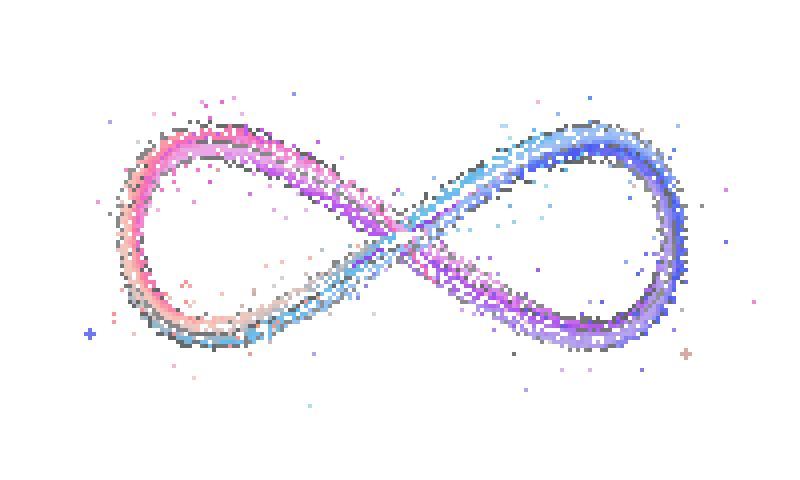
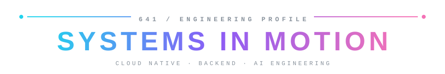

<!-- Profile README for github.com/641-git641 -->

  

  

 

---

  

 

<!-- COMPONENT BAY: append new skill IDs to the i= list; perline=7 keeps the bay exactly two rows deep. -->

  

<!-- SIGNAL PANEL: keep each phrase short enough for the 440px frame. -->

  

